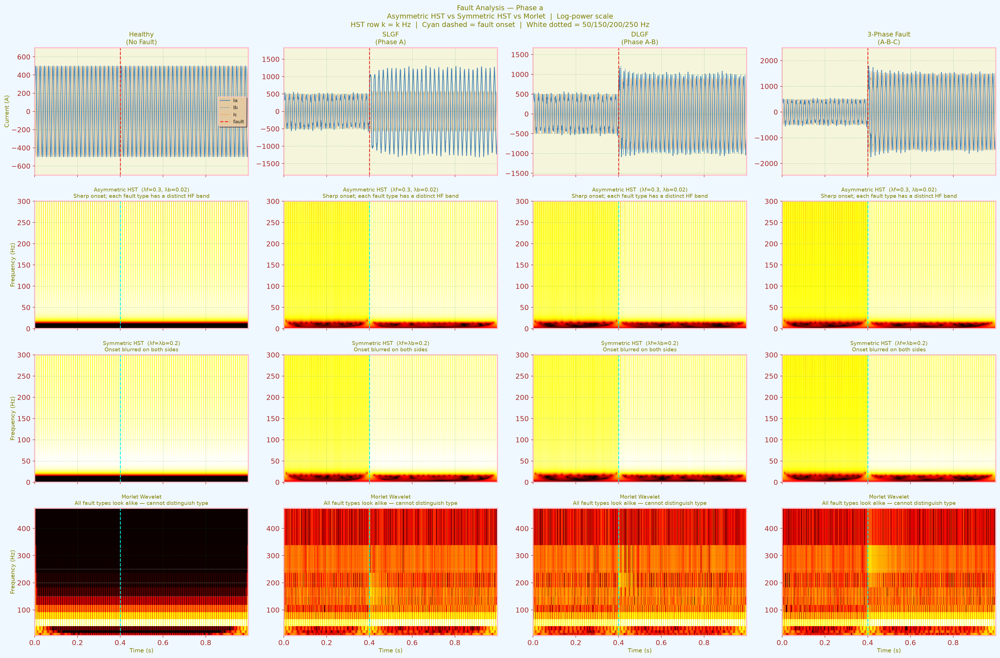
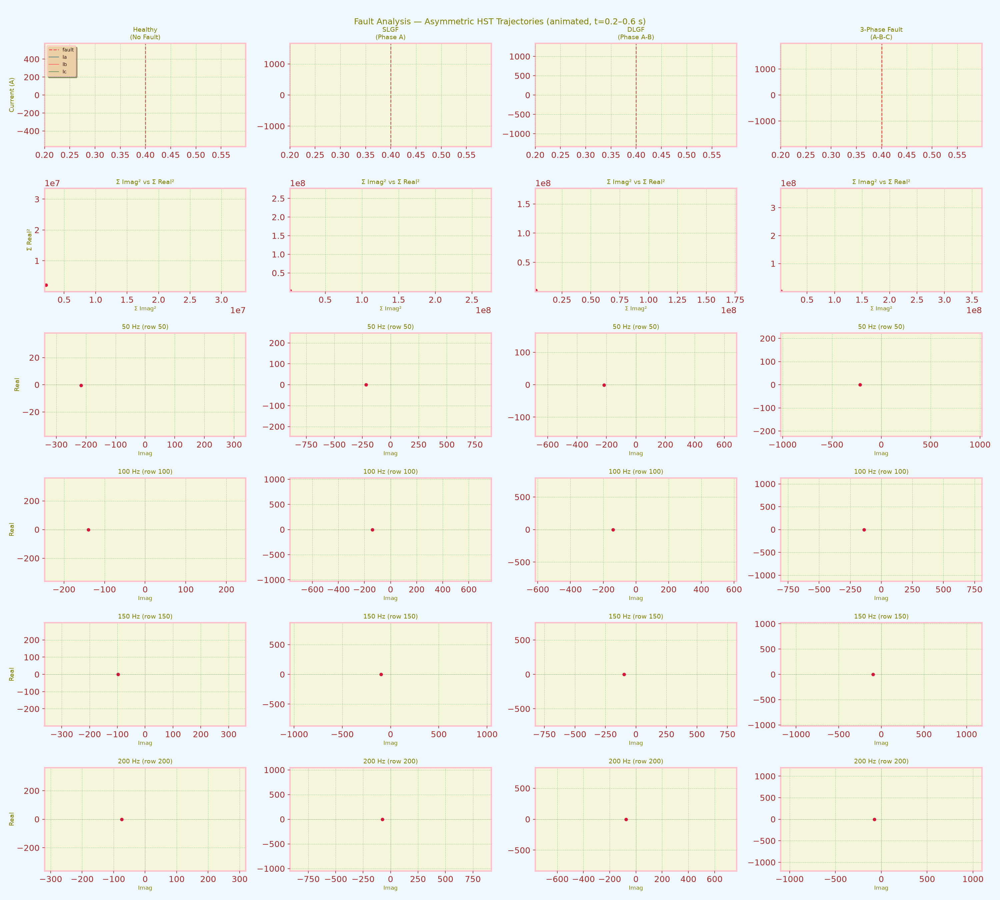

# Hyperbolic S-Transform

[](https://pypi.org/project/HSTransform/)
[](https://pepy.tech/project/hstransform)
[](https://pepy.tech/project/hstransform)
[](https://github.com/nvlinhvn/HSTransform/actions/workflows/ci.yml)
[](https://github.com/nvlinhvn/HSTransform/actions)
[](https://github.com/nvlinhvn/HSTransform/actions)
[](https://pypi.org/project/HSTransform/)
[](LICENSE)
[](https://mypy-lang.org/)
[](https://github.com/astral-sh/ruff)
[](https://ieeexplore.ieee.org/document/8423487)

## 1. Introduction

HSTransform is a Python package for the Hyperbolic [S-transform](https://en.wikipedia.org/wiki/S_transform) [[1]](#1). The S-transform is a time-frequency representation that combines the best properties of the Short-time Fourier Transform and the Wavelet Transform — simultaneous frequency content and temporal localisation.

The hyperbolic variant introduces an asymmetric Gaussian window via a hyperbolic coordinate transformation. Unlike the standard S-transform (which has equal causal and anti-causal decay), the hyperbolic window decays at different rates before and after each time point, controlled by `forwardtaper` and `backwardtaper`. This makes it better suited for detecting one-sided transients such as voltage sags, fault inception, and impulsive disturbances in power systems.

This package implements the algorithm from the author's [published paper](https://ieeexplore.ieee.org/document/8423487).

---

## 2. What changed in v0.2.0

### 2.1 Algorithmic corrections

Three bugs were found and fixed in the core algorithm, two of which were MATLAB→Python porting errors.

**Bug 1 — Window was a scalar, not a vector (MATLAB port)**

The hyperbolic Gaussian window must be a 1D vector applied pointwise to the shifted FFT spectrum. The original code called `np.sum(g)` without an axis argument, which collapses the entire matrix to a scalar. In MATLAB, `sum(A)` on a 2D matrix sums along columns; in NumPy, `np.sum(A)` without `axis=` sums all elements. The fix: `np.sum(g, axis=0)`.

With a scalar window, all frequency rows were effectively weighted by the same constant — the time-frequency localisation of the transform was completely broken.

**Bug 2 — DC row alternating pattern (MATLAB port)**

The DC row of the S-transform (frequency = 0) should be the signal mean repeated at every time step. The original code used `1 & np.arange(1, n+1)`, which in MATLAB is logical AND (all ones) but in Python/NumPy is bitwise AND, producing `[1, 0, 1, 0, ...]`. Every other DC-row sample was zeroed. The fix: `np.ones(n)`.

**Bug 3 — Window was real-valued, losing asymmetry (algorithmic)**

Even after fixing Bug 1, the frequency-domain window was computed as a real-valued sum over all time samples without a complex phase term. The correct frequency-domain window is the Discrete Fourier Transform of the time-domain hyperbolic Gaussian — and because the window is asymmetric in time (`forwardtaper ≠ backwardtaper`), its DFT is genuinely complex. Without the phase term, all causal/anti-causal information was averaged out, making the output identical to a symmetric window regardless of the taper values.

The fix replaces the old sum with a proper DFT:
```python
g = (k / sqrt(2π)) * exp(-x(t)² * k² / 2)   # time-domain hyperbolic Gaussian
G = fft(g) * dt                                # frequency-domain window (complex)
```

**Bug 4 — FFT slice off-by-one (MATLAB port)**

The shifted FFT spectrum was sliced as `h[k+1:k+n+1]` instead of `h[k:k+n]`. In MATLAB, `h(k+1:k+n)` with 1-based indexing translates to Python's `h[k:k+n]`, not `h[k+1:k+n+1]`. The off-by-one shifted every frequency row by one bin.

### 2.2 Modern packaging

| Before (v0.1) | After (v0.2) |
|---|---|
| `setup.py` + `requirements.txt` | `pyproject.toml` (PEP 517, hatchling) |
| `pandas` as hard runtime dependency | Removed — only `numpy` and `scipy` required |
| `pytest` listed as runtime dependency | Moved to `[dev]` optional group |
| No type annotations | Full `mypy --strict` type hints |
| Python 3.10 | Python ≥ 3.12 |

### 2.3 Algorithmic corrections in v0.2.1

Two additional bugs were found and fixed in the core window construction:

**Bug 5 — Frequency scaling used bin index instead of physical frequency**

The Gaussian exponent used `k` (DFT bin index) where physical frequency `f_k = k / (N·Δt)` is required. The window width was incorrect whenever the record duration `N·Δt ≠ 1 s`, and the transform was not invariant to changes of time unit. The fix: replace `k_f = float(k)` with `f_k = float(k) / (n * dt)`.

**Bug 6 — Hyperbola centred by vertical subtraction instead of horizontal translation**

The code subtracted `x(0) = (λf−λb)√c / (2λfλb)` from the coordinate (vertical shift) instead of translating the hyperbola's argument by `ζ = (λf−λb)√c / (2√(λfλb))` (horizontal shift). Both produce `X(0) = 0`, but they are geometrically different curves with different slopes and asymptotic behaviour. This caused incorrect window shapes for all asymmetric (`λf ≠ λb`) configurations. The reference construction is from Pinnegar & Mansinha (2003).

### 2.4 Robustness improvements in v0.2.2

- **Constructor validation**: `forwardtaper`, `backwardtaper`, and `curvature` must be finite and positive; invalid values raise `ValueError` immediately on construction.
- **Signal validation**: signal must be 1-D, ≥ 2 samples, finite (no NaN or ±inf).
- **Time array validation**: `time_values` must match signal length, be strictly ascending, and be uniformly spaced.
- **Frequency parameter validation**: `minf`, `fsamplingrate`, and `maxf` are checked for valid integer types and ranges before any computation.
- **Configurable `maxf`**: `fit_transform` now accepts a `maxf` keyword to limit the highest frequency bin returned.
- **`frequency_axis` helper**: new method returns the physical frequency in Hz for each row of the transform output, matching the same `minf`/`fsamplingrate`/`maxf` arguments.

### 2.5 Test suite

The original package had 2 tests. The current suite ships with 98 tests covering:

- Input validation (wrong type, NaN, inf, non-1D, length mismatch, non-uniform time, complex timestamps, float32 and large-origin time grids)
- Constructor validation (zero/negative/nan tapers and curvature)
- Mathematical invariants: linearity, voice synthesis, window normalization (DC = 1), pure-tone constant ridge
- Hyperbolic window properties: symmetric tapers → real window; asymmetric tapers → complex window; impulse asymmetric decay
- Parametrized across taper values, curvature, signal frequencies, and sampling rates
- Regression guards for all six fixed bugs, including time-unit invariance and minf > 0 bin selection
- Independent direct-sum oracle tests that verify production `fit_transform` against reference weights built without calling any internal method
- Robustness guards for all new parameter validation paths

Coverage: 97%.

---

## 3. Installation

```bash
pip install HSTransform
```

For development:

```bash
git clone https://github.com/nvlinhvn/HSTransform
cd HSTransform
pip install -e ".[dev]"
```

---

## 4. Usage

```python
import numpy as np
from hstransform import HSTransform

# Create a signal: 1000 samples at 1 kHz (bin k == k Hz exactly)
fs = 1000
n  = 1000
t  = np.arange(n) / fs          # endpoint-exclusive: dt = 0.001 s, n*dt = 1 s

V = 220 * np.sqrt(2) * np.sin(2 * np.pi * 50 * t)
V_sag = np.where((t >= 0.2) & (t <= 0.25), 0.5 * V, V)

# Run the transform
hs = HSTransform(
    forwardtaper=0.2,   # decay rate toward future samples (t > τ)
    backwardtaper=0.1,  # decay rate toward past samples (t < τ)
    curvature=0.25,     # controls onset of hyperbolic asymmetry; use ≲ (record duration)²
)
S = hs.fit_transform(t, V_sag)   # shape: (n_freq, n_time), complex

# S[k, :] = time series of frequency bin k (= k Hz when n*dt = 1 s)
# np.abs(S[50, :]) = localized complex spectral magnitude at 50 Hz
#   For a real cosine of amplitude A, the mean magnitude across time is A/2
#   (not A) because the DFT splits energy between +k and -k bins.
#   Individual sample magnitudes vary around A/2 due to negative-frequency
#   image leakage; the A/2 approximation holds when image leakage is negligible.
```

### Parameters

| Parameter | Default | Meaning |
|---|---|---|
| `forwardtaper` | `0.2` | Controls window decay toward **future** samples (`t > τ`, negative lag). Smaller = narrower future-looking tail = less pre-event energy from an upcoming transient. For sharp onset detection with minimal pre-event bleed, **decrease `forwardtaper`**. |
| `backwardtaper` | `0.1` | Controls window decay toward **past** samples (`t < τ`, positive lag). Smaller = narrower past-looking tail = faster post-event decay. |
| `curvature` | `312.5` | Controls when the hyperbolic asymmetry activates. The asymmetric term in the coordinate transform is `(λf−λb)√(t²+curvature)`, which only differs meaningfully from a constant when `t² ≳ curvature`. **Rule of thumb: set `curvature ≲ (record duration)²`.** For `t = np.arange(n)` (sample-indexed), default 312.5 is appropriate. For `t ∈ [0,1]` (normalised), use `curvature ≈ 0.01–0.25`; otherwise the asymmetry is invisible. |

When `forwardtaper == backwardtaper`, the window is a symmetric Gaussian.

### `fit_transform` and `frequency_axis` signatures

```python
S = hs.fit_transform(
    time_values,        # 1D uniformly-spaced time array, same length as signal
    input_signal,       # 1D finite real or complex signal
    minf=0,             # minimum frequency bin index (default 0 = include DC)
    fsamplingrate=1,    # bin step (1 = every bin, 2 = every other, …)
    maxf=None,          # maximum bin (default: min(900, n // 2))
)
# Returns: complex ndarray of shape (len(bins), n)
# where bins = np.arange(minf, effective_maxf+1, fsamplingrate)

# Get physical Hz label for each row:
freqs = hs.frequency_axis(n, dt, minf=0, fsamplingrate=1, maxf=None)
# freqs[j] = bins[j] / (n * dt)  in Hz
```

### Time-axis convention and frequency labeling

Use `t = np.arange(n) / fs` (endpoint-exclusive) rather than `np.linspace(0, T, n)`.  
When the record duration `n * dt = 1 s` exactly, row `k` maps to exactly `k` Hz.  
For other durations, use `frequency_axis()` to get the correct Hz labels.

### Finite circular-window contract

The implementation normalizes a single-period window cropped to `n` samples and treats the time axis as circular (via `fftfreq`). The continuous Gaussian window has infinite support; this discrete version loses tail energy for broad windows (small frequency bin or large taper values). This is expected behaviour, not a bug: the window integrates to 1 over the cropped period so DC is preserved, but magnitude values for broad windows are not directly comparable to the continuous formula.

The finite approximation is accurate when two independent conditions hold simultaneously:
1. **Negligible tails**: the window must fit within the cropped period — satisfied at high frequency bins or small tapers.
2. **Adequate sampling**: the window must span enough samples to be well resolved — satisfied at low frequency bins or large tapers.

These conditions pull in opposite directions. In particular, very high frequency bins can have _worse_ continuous-transform accuracy due to undersampling (a narrow window resolved by only a fraction of a sample). Use `frequency_axis()` together with the rule-of-thumb `window_SD_samples ≈ γ · N / k` (where `γ` is the taper value) to assess whether both conditions are met for a given configuration.

### Phase convention

The carrier phase is relative to `t[0] = 0` (sample zero), not the physical start time.  
If your time axis starts at `t₀ ≠ 0` and you need phase relative to that physical origin,
multiply each row `k` by `exp(-2πi · f_k · t₀)` after the transform.

---

## 5. Run tests

```bash
pytest tests/ --cov=hstransform
```

---

## 6. Examples

### 6.1 Power quality disturbances — spectrogram comparison

Four voltage disturbance types (Sag, Swell, Spike, Notch) on a 50 Hz, 220 V signal, compared between HST and Morlet Wavelet:


See also [Section 1.3 of the notebook](notebooks/demo.ipynb) for the same comparison across three signal parameterisations (saved as `notebooks/pq_comparison_*.png` when the notebook is run): the standard 1 kHz / 2 s setup above, a 10 s record matching a common user example, and a 10 kHz / 0.2 s sub-cycle setup where HST's exact Hz axis is most useful.

HST (middle row, 0–200 Hz) maps every frequency bin independently and linearly to its exact Hz value. Disturbances appear as amplitude changes at the fundamental and harmonics. The Morlet CWT (bottom row, 0–800 Hz pseudo-frequency) spans a much wider range via log-spaced scales, and also detects broadband features like spikes and notches. The two representations are not directly comparable: the y-axes cover different ranges, the Morlet frequency axis is pseudo-frequency (approximate Hz derived from scale and wavelet center frequency), and the color scales are not normalized to the same reference.

### 6.2 Power quality disturbances — real/imaginary trajectories

The HST output is complex-valued. Plotting `Re(S[k, t])` vs `Im(S[k, t])` at a given frequency traces a trajectory in the complex plane that is characteristic of the disturbance type:


*Static version: [power_quality_disturbance_trajectory.png](notebooks/power_quality_disturbance_trajectory.png)*

Each HST disturbance type produces a geometrically distinct shape at 50 Hz — nested circles (sag: inner orbit during reduced amplitude), larger circle (swell), extended lobe (spike: single-sample impulse deflects the orbit), and a pinched circle (notch: brief zero-crossing). The real Morlet rows are flat horizontal lines with `Im(CWT) = 0` identically: `pywt.cwt` with the `'morl'` wavelet returns real coefficients, so no trajectory is possible. Note: the complex Morlet wavelet (`'cmor'` in PyWavelets) does support complex coefficients and trajectories; the flat-line result here is specific to the real `'morl'` configuration used in these examples.

### 6.3 Power system faults — spectrogram comparison

Four 3-phase fault scenarios (Healthy, SLGF, DLGF, 3-Phase) with additive harmonics and noise. Asymmetric HST (`λf=0.3`, `λb=0.02`) vs symmetric HST vs Morlet:



HST (rows 2 and 3) shows the fault onset as an abrupt step in high-frequency energy: pre-fault rows are dark, post-fault rows show structured harmonic bursts whose frequency pattern differs by fault type (SLG concentrates energy differently from 3-Phase). The Morlet (bottom row) also detects the fault clearly — it does not go dark — but the spectral patterns across the four fault types are harder to visually distinguish because the log-spaced scales mix frequency and time resolution in a way that blurs the harmonic structure. The asymmetric window (`λf=0.3`, `λb=0.02`) sharpens the post-fault onset edge relative to the symmetric window; for minimal pre-event smearing, use a smaller `forwardtaper` (e.g. `λf=0.02, λb=0.3`).

### 6.4 Power system faults — real/imaginary trajectories

Asymmetric HST complex trajectories at 50, 100, 150, and 200 Hz for each fault type:



*Static version: [fault_trajectory.png](notebooks/fault_trajectory.png)*

Each fault type traces a distinct shape in the complex plane at each frequency — clean circles in the healthy case, collapsed or interrupted orbits under single-line-to-ground fault, and starburst patterns under three-phase fault. The shapes differ across both fault types and frequency rows, making them usable as discriminative features for classification. The real `'morl'` wavelet provides no equivalent: its output has no imaginary part and produces no trajectory. (The complex Morlet wavelet `'cmor'` does support complex trajectories, but was not evaluated here.)

**When to use HST instead of Morlet:**

| Scenario | Best choice | Reason |
|---|---|---|
| Fault inception / one-sided transients | Asymmetric HST (small `forwardtaper`) | Reduces pre-event bleed; smaller `forwardtaper` = less energy from the future |
| Fault / disturbance type classification via trajectory | HST | `S[k,:]` is complex → 2D trajectory per frequency; `pywt.cwt('morl')` (real Morlet) is real → trajectory is a flat line. Complex Morlet (`'cmor'`) does support trajectories. |
| Uniform Hz labeling across all rows | HST | HST row k = k/(N·Δt) Hz exactly; Morlet pseudo-frequency is scale-convention-dependent |
| Broadband impulsive events (spike, lightning) | Either | Both detect them; HST labels each row in exact Hz, Morlet uses approximate pseudo-frequency |
| Stationary periodic signals only | Either | Morlet is simpler; HST adds no advantage |

---

## 7. References

<a id="1">[1]</a>
Stockwell, R.G., Mansinha, L. & Lowe, R.P. (1996).
Localization of the complex spectrum: the S transform.
*IEEE Trans. Signal Process.*, 44(4), 998–1001. doi:10.1109/78.492555

---

## 8. Citation

If you use HSTransform in your research, please cite:

> Linh V Nguyen (2024). HSTransform (Version 0.2.1) [Computer software]. GitHub: github.com/nvlinhvn/HSTransform

---

## 9. Contact

Questions, issues, or suggestions: open a GitHub issue or email linhvietnguyen.ee@gmail.com
